<h1 align="center">Zain Tariq</h1>

  <b>AI/ML Engineer | Deep Learning | Computer Vision | RAG and Edge AI</b> 
  I build models and ship them as working apps, from training to a live demo.

  
  
  

  

  
  
  

---

## Selected Work

Click a project to see what it does, the result, and the links.

<b>Skin Cancer Classification</b> &nbsp;|&nbsp; CNN, transfer learning &nbsp;|&nbsp; 90.49% accuracy

 

Classifies skin lesions as benign or malignant on the HAM10000 dataset using ResNet50.

- **Result:** 90.49% accuracy, 0.95 AUC-ROC
- **Built with:** TensorFlow, Keras, ResNet50

[Code](https://github.com/zaintariq967/Skin-Cancer-Classification) &nbsp;|&nbsp; [Live demo](https://YOUR-DEMO-URL)

<b>Chat-Driven Object Detection</b> &nbsp;|&nbsp; YOLOv8, NLP &nbsp;|&nbsp; ask questions about a video

 

Detects objects in video with YOLOv8, then lets you ask plain-language questions about what was seen.

- **Result:** Natural-language queries over detection results through a Flask web UI
- **Built with:** YOLOv8, OpenCV, spaCy, Flask

[Code](https://github.com/zaintariq967/AI-Chat-Driven-Object-Detection-Analysis-Assistant) &nbsp;|&nbsp; [Live demo](https://YOUR-DEMO-URL)

<b>RAG Knowledge Chatbot</b> &nbsp;|&nbsp; LLM, FAISS &nbsp;|&nbsp; answers grounded in your documents

 

Retrieval-Augmented Generation chatbot over a structured knowledge base with a responsive web UI.

- **Result:** Answers grounded in retrieved context rather than the model's guesses
- **Built with:** GPT-OSS-120B on Groq, LangChain, FAISS, Tailwind

[Code](https://github.com/zaintariq967/AI-powered-Corvit-Systems-chatbot) &nbsp;|&nbsp; [Live demo](https://YOUR-DEMO-URL)

<b>Edge Computer Vision on Raspberry Pi 4</b> &nbsp;|&nbsp; real-time lane and object detection

 

Runs a perception pipeline on a Raspberry Pi 4, detecting lanes and objects from a live camera feed.

- **Result:** Real-time inference on edge hardware
- **Built with:** OpenCV, TensorFlow Lite, Picamera2

[Code](https://github.com/zaintariq967/Vision-Based-Autonomous-Perception-System) &nbsp;|&nbsp; [Demo video](https://YOUR-DEMO-URL)

<b>CuRoCart</b> &nbsp;|&nbsp; IoT autonomous shopping cart &nbsp;|&nbsp; FYDP 2nd Position

 

An autonomous shopping cart with automated billing and a Flutter companion app.

- **Result:** 2nd position, Final Year Design Project (FYDP)
- **Built with:** ESP32, HX711 load cell, ultrasonic and IR sensors, Flutter

[Code](https://github.com/YOUR-USERNAME/REPO) &nbsp;|&nbsp; [Demo video](https://YOUR-DEMO-URL)

<b>More projects</b>

 

- **[IoT Network Anomaly Detection](https://github.com/zaintariq967/AI-Powered-Network-Anomaly-Detection):** Isolation Forest and XGBoost on CICIoT2023 with a Streamlit dashboard
- **[PilgrimAI Analytics](https://github.com/zaintariq967/PilgrimAI-Islamic-Pilgrimage-Analytics):** gradient boosting forecasts on 25+ years of pilgrimage data (R² = 0.8173)
- **[Solar Panel Defect Detection](https://github.com/zaintariq967/Solar-Panel-Defect-Detection--And-Severity-Estimation-using-CNN):** CNN defect classification and severity estimation (VGG16, ResNet50)
- **[Email Spam Detection](https://github.com/zaintariq967/Intelligent-Email-Spam-Detection-Using-Machine-Learning-and-Natural-Language-Processing):** TF-IDF classifier with a Gradio UI (95% F1)
- **[Multi-Threaded TCP Chat Server](https://github.com/zaintariq967/Multi-Threaded-TCP-Chat-Server):** concurrent server in C with pthreads and sockets

---

## Currently

  

---

## Stack

Python, TensorFlow, Keras, OpenCV, YOLOv8, scikit-learn, LangChain, FAISS, Hugging Face, Flask, Streamlit, Gradio, Raspberry Pi, ESP32, C/C++.

## Open to

Fresher roles in AI/ML engineering, computer vision, deep learning and GenAI. Reach me on [LinkedIn](https://www.linkedin.com/in/mzaintariq967/) or at [zaintariq967@gmail.com](mailto:zaintariq967@gmail.com).
